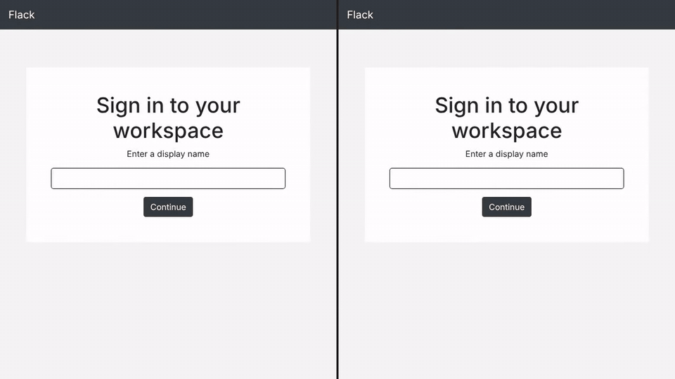

# Flack

A Slack-style chat app built with Flask and Flask-SocketIO. Users pick a display name, create channels and chat in real time, with new messages appearing in every open browser without a page refresh. It was my Project 2 for Harvard's CS50 Web Programming with Python and JavaScript. There is no database: channels and messages are kept in the server's memory.



## Features

- **Display names:** sign in with just a display name. It is stored in the server-side session, so returning to the site skips the sign-in page.
- **Real-time messages:** messages are sent over Socket.IO and broadcast to everyone, each with the sender's name and the time it was sent.
- **Channels:** create a channel from the **+** button. Names may only contain letters and numbers, and a channel name that already exists is refused. Everyone starts in `#general`.
- **Channel history:** switching channels loads that channel's messages from the server, and each channel keeps up to 100 messages. Once a channel reaches 100, new messages are refused with an alert.
- **Remembers your channel:** the last channel you viewed is saved in the browser's `localStorage` and reopened when you come back.
- **Delete your own messages:** your own messages show an **x** button that fades the message out with a CSS animation and removes it on the server.

## How it works

1. `GET /` shows the sign-in form until a display name is stored in the session. `POST /login` saves the name and redirects to the chat page.
2. `static/main.js` connects to the server with Socket.IO. Sending a message emits a `new msg` event. The server stores it in that channel's list and broadcasts an `announce message` event, and every client in that channel adds it to the page using a Handlebars template.
3. Creating a channel emits `new channel`. The server adds it to the channel list and broadcasts `announce channel`, and each client reloads to show the new channel.
4. Clicking a channel requests `GET /channel/<name>`, which returns that channel's messages as JSON.
5. Deleting a message calls `GET /delete_msg/<channel>/<message>`, which removes the matching message from the server's list.

All data lives in Python lists and dictionaries in `application.py`, so it is cleared whenever the server restarts.

## Project structure

```
application.py        Flask routes and Socket.IO event handlers
requirements.txt      Python packages (unpinned)
templates/
├── login.html        Display name form
└── index.html        Chat page, plus Handlebars templates for messages and channels
static/
├── main.js           Socket.IO client, channel switching, message rendering and deleting
└── style.css         Layout, colours and the delete animation
docs/demo.gif         Demo recording
```

## Running it locally

The page loads the Socket.IO 2.3.0 client, which only works with Flask-SocketIO 4.x. `requirements.txt` doesn't pin versions, so install these 2020-era versions instead. I tested it with **Python 3.8**:

```bash
git clone https://github.com/sangyetenphel/cs50-flack.git
cd cs50-flack
python3.8 -m venv venv
source venv/bin/activate
pip install "Flask==1.1.2" "Werkzeug==1.0.1" "Jinja2==2.11.3" "MarkupSafe==1.1.1" \
    "itsdangerous==1.1.0" "click==7.1.2" "Flask-Session==0.3.2" \
    "Flask-SocketIO==4.3.1" "python-socketio==4.6.0" "python-engineio==3.13.2"
```

Then start the server with a secret key of your own:

```bash
export FLASK_APP=application.py
export SECRET_KEY=change-me
flask run
```

Open http://127.0.0.1:5000 in two different browsers (or one normal and one private window) to chat between two users. The pages load Bootstrap, jQuery, Socket.IO, Handlebars and Font Awesome from public CDNs, so an internet connection is needed.

## Built with

- **Backend:** Python, Flask, Flask-SocketIO and Flask-Session
- **Frontend:** JavaScript, Socket.IO client, Handlebars, Bootstrap 4 and Font Awesome

## Course credit

Built for Project 2 of [CS50's Web Programming with Python and JavaScript](https://cs50.harvard.edu/web/) (Harvard University, 2020 edition). The original course submission video is on [YouTube](https://youtu.be/ruAgZ_EHPUo).

## Known limitations

- Deleting a message removes it on the server and on your own screen, but other users keep seeing it until they switch channels or reload.
- Messages and channels are lost when the server restarts, since there is no database.

Created by Sangye Tenphel, 2020.
